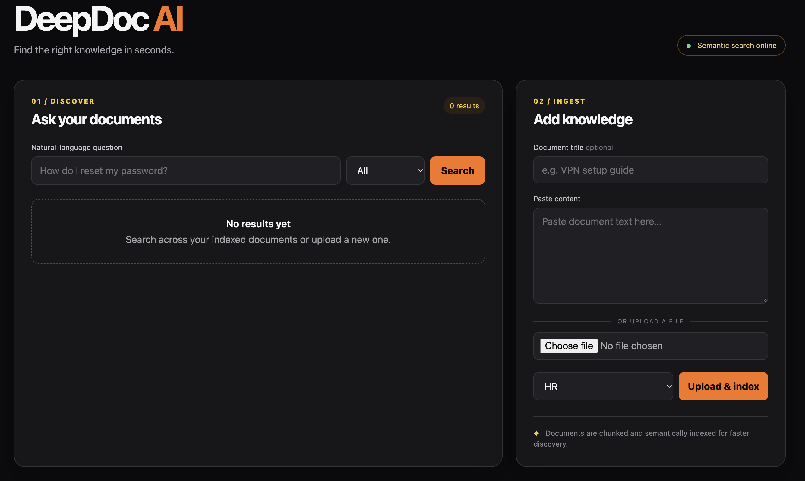

# DeepDoc AI



**DeepDoc AI** is a semantic search platform built with a FastAPI backend and a React (JavaScript/Vite) frontend. It enables users to upload internal documents (text, PDF, or DOCX), organize them by department, and perform semantic search powered by Elasticsearch.


## Features

* Semantic search using embedding-based reranking
* Upload documents via text or file input
* Grouping by department and title metadata
* Automatic chunking and embedding of large documents
* Full document retrieval via `doc_id`
* Clean UI with expandable results in modal view
* Delete documents directly from the frontend
* Automatic Elasticsearch index creation


## Tech Stack

| Layer        | Technology                          |
| ------------ | ----------------------------------- |
| Frontend     | React + TypeScript                  |
| Backend      | FastAPI (Python)                    |
| Search       | Elasticsearch                       |
| Embeddings   | `all-MiniLM-L6-v2` via HuggingFace  |
| File Parsing | `pdfplumber`, `python-docx`         |


## Getting Started

### 1. Clone the repository

```bash
git clone <repository-url>
cd deepdoc-ai
```

### 2. Run Elasticsearch (Docker)

Elasticsearch must be running before starting the backend service.

#### For macOS users

Docker Desktop must be started manually before proceeding.

#### Start Elasticsearch

From the project root:

```bash
cd backend/scripts
./start_elasticsearch.sh
```

This will launch Elasticsearch in single-node mode using Docker Compose:

```bash
docker compose -f ../docker/elasticsearch-compose.yml up -d
```

Security features are disabled for local development.

#### Stop Elasticsearch (after finishing all tasks)

Once application tasks are complete, the Elasticsearch container can be shut down:

```bash
./stop_elasticsearch.sh
```

This ensures that resources are freed and the search service is gracefully terminated.

### 3. Backend Setup


```bash
cd backend
python -m venv venv
source venv/bin/activate  # or venv\Scripts\activate on Windows
pip install -r requirements.txt
uvicorn app.main:app --reload
````

`.env` should contain backend config (Elasticsearch URL, index name, model, etc.)

#### Seed Documents

To help with initial testing and demonstration, the backend includes logic to **automatically insert seed documents** into Elasticsearch when the application starts, but only if the index does not already exist.

This behavior is controlled by the `insert_seed_data` setting in the `.env` file:

```env
# .env
insert_seed_data=true
```

When enabled, the following happens at startup:

* The backend checks if the configured Elasticsearch index exists.
* If it doesn’t, the index is created.
* If `insert_seed_data` is set to `true`, predefined seed documents are inserted automatically.

This logic is handled in `main.py`. You can find or customize the seed content in:

```
backend/app/seed_data.py
```

This feature is useful for:

* Demo setups
* Development and testing environments
* Verifying UI/UX without manual uploads

### 4. Frontend Setup

```bash
cd frontend
npm install
npm run dev
```

Frontend environment variables must be defined in `frontend/.env`, for example:

```env
VITE_API_BASE_URL=http://localhost:8000
```

## Running Tests (Backend)

`pytest` is used for testing the backend.

### Install `pytest` (if not already installed):

```bash
pip install pytest
```

### Run tests from the `backend` directory:

```bash
cd backend
PYTHONPATH=. pytest
```

> Note: The `PYTHONPATH=. ` prefix ensures test files can import from the `app/` module correctly.

Test files are located in `backend/tests` directory


## API Overview

| Endpoint                        | Method | Description                       |
| ------------------------------- | ------ | --------------------------------- |
| `/search`                       | POST   | Perform a semantic search         |
| `/upload`                       | POST   | Upload a text document            |
| `/upload-file`                  | POST   | Upload a file (.pdf, .docx)       |
| `/delete/doc_id/{doc_id}`       | DELETE | Delete all chunks by `doc_id`     |
| `/document/full/{key}/{doc_id}` | GET    | Retrieve the full merged document |

## Folder Structure

```
deepdoc-ai/
├── backend/
│   ├── app/
│   │   ├── main.py
│   │   ├── config.py
│   │   ├── models.py
│   │   ├── seed_data.py
│   │   ├── api/
│   │   │   ├── __init__.py
│   │   │   └── search.py
│   │   ├── services/
│   │   │   ├── __init__.py
│   │   │   ├── elastic.py
│   │   │   ├── embedding.py
│   │   │   └── utils.py
│   ├── docker/
│   │   └── elasticsearch-compose.yml
│   ├── scripts/
│   │   ├── check_elasticsearch.py
│   │   ├── start_elasticsearch.sh
│   │   └── stop_elasticsearch.sh
│   ├── tests/
|   |   ├── test_app.py
|   |   └── test_health.py
│   ├── requirements.txt
│   └── .env
├── frontend/
│   ├── src/
│   │   ├── App.jsx
│   │   ├── main.jsx
│   │   ├── services/
│   │   │   └── api.js
│   │   └── styles.css
│   ├── public/
│   └── .env
├── README.md
```

## Project Demo

The frontend of DeepDoc AI is built with React, Vite, and JavaScript, offering a responsive interface for uploading documents, performing semantic search, and managing document results.

## Future Improvements

* Document versioning
* User authentication and access control
* Multi-language embedding support
* Usage analytics dashboard
* RAG pipeline
